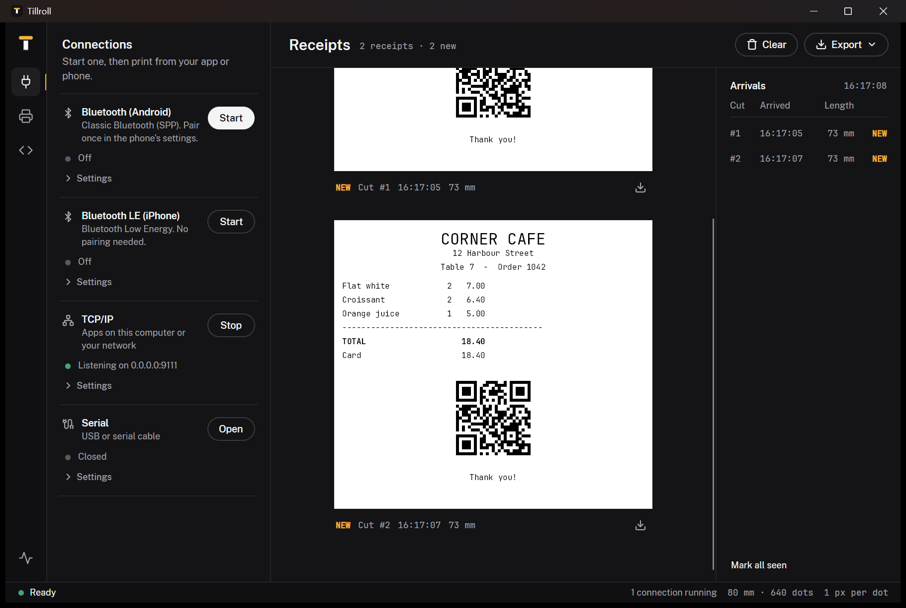

<p align="center">
  <picture>
    <source media="(prefers-color-scheme: dark)" srcset="branding/tillroll-lockup-dark.svg">
    
  </picture>
</p>

<p align="center"><b>A virtual receipt printer for developers and QA.</b><br>
Print from your app or phone over Bluetooth, TCP, serial or USB, and see every receipt dot for dot.</p>

<p align="center">
  <a href="https://github.com/hasana3n/tillroll/actions/workflows/ci.yml"></a>
  <a href="https://github.com/hasana3n/tillroll/releases/latest"></a>
  <a href="LICENSE"></a>
  
</p>

<p align="center">
  <a href="#download">Download</a> •
  <a href="#quick-start">Quick start</a> •
  <a href="#print-from-a-phone">Phones</a> •
  <a href="docs/README.md">Docs</a> •
  <a href="https://hasana3n.github.io/tillroll/app/">Try it in the browser</a>
</p>

<p align="center">
  
</p>

Testing receipt printing usually means a real printer, a roll of paper and a lot of walking back and forth.
Tillroll stands in for the printer. Point your point-of-sale app at it, or print from a phone, and each receipt
appears on screen exactly as a thermal printer would print it. It answers status queries too, so you can test how
your app handles an open cover, running out of paper or a cash drawer.

## What it does

- **Acts as a printer on every connection a real one has.** TCP/IP on port 9100, serial, and on Windows and
  Linux a Bluetooth printer for phones: Classic Bluetooth (SPP) for Android apps and Bluetooth LE for iPhone
  apps. In the browser: Web Serial, WebUSB and a TCP relay.
- **Shows the truth of the print.** Every printer dot is drawn as whole screen pixels, never smoothed. 58 mm and
  80 mm paper, text styles, 1D barcodes, QR, PDF417, DataMatrix, Aztec, bit images and page mode.
- **Talks back.** Answers `DLE EOT`, `GS r` and Automatic Status Back. Simulate offline, an open cover, low or no
  paper, errors and the cash drawer, and the printer drops jobs while it isn't ready, like real hardware.
- **Keeps up with you.** An arrivals board lists every cut with its time and length, and a **NEW** lamp stays lit
  until you've looked at it. The status strip says whether the printer would print right now, and why not.
- **Comes with a test client.** The Monitor prints sample jobs and shows the status your app would receive.
- **Exports PNGs.** One receipt, all of them in one image, or one file per cut.
- **Embeds in your code.** A headless core turns ESC/POS bytes into images with no UI, with SkiaSharp or a fully
  managed ImageSharp backend.

## Download

| Platform | Download | What you get |
|---|---|---|
| **Windows** (x64) | [Tillroll-win-x64.zip](https://github.com/hasana3n/tillroll/releases/latest/download/Tillroll-win-x64.zip) | `Tillroll.exe`, portable: unzip and run |
| **Linux** (x64) | [Tillroll-linux-x64.tar.gz](https://github.com/hasana3n/tillroll/releases/latest/download/Tillroll-linux-x64.tar.gz) | `Tillroll`, portable: unpack and run |
| **macOS** | [Apple silicon](https://github.com/hasana3n/tillroll/releases/latest/download/Tillroll-osx-arm64.zip) · [Intel](https://github.com/hasana3n/tillroll/releases/latest/download/Tillroll-osx-x64.zip) | `Tillroll.app` (see [Troubleshooting](#troubleshooting)) |
| **Browser** | [Open Tillroll in your browser](https://hasana3n.github.io/tillroll/app/) | Nothing to install |

Every desktop build is self-contained, so you don't need .NET. The Windows and Linux builds are a single executable
plus `LibUsbDotNet.dll`, which ships beside it under its own licence (LGPL-3.0); keep the two together. The
[release notes](https://github.com/hasana3n/tillroll/releases) list what changed.

## Quick start

1. Start Tillroll. It listens on TCP port 9100 straight away.
2. Print to it from your app (as a network printer at `localhost:9100`), or from a terminal:

   ```sh
   printf 'Hello from Tillroll\n\n\n\035V\000' | nc -w 1 localhost 9100
   ```

3. Open the **Printer** panel (the printer icon on the left) and flip a switch, such as **Cover open**, to see
   what your app does when the printer isn't ready. **Monitor** at the bottom of the rail sends sample jobs and
   shows the status replies.

Change the port, open a serial port or test serial without hardware: see [Connecting](docs/Connecting.md).

## Print from a phone

On Windows or Linux, click **Start** on a Bluetooth row and print from your phone app:

- **Android:** start **Bluetooth (Android)**, pair the phone with this computer once in the phone's Bluetooth
  settings, then connect from your app with the standard SPP UUID `00001101-0000-1000-8000-00805F9B34FB`.
- **iPhone and iPad:** start **Bluetooth LE (iPhone)** and scan from your app for the printer service `18F0`
  (two other common printer profiles, `E7810A71-…` and `49535343-…`, are offered too). No pairing; don't pair it
  in iOS Settings.

[Bluetooth](docs/Bluetooth.md) covers the UUIDs, phone-side code in Kotlin and Swift, and a test you can run with a
free phone app before writing any code.

## Use it from code

```csharp
var printer = new ReceiptPrinter(PaperConfiguration.Default,
    new SkiaImageFactory(), new SkiaTypefaceProvider());
printer.FeedEscPos(escPosBytes);                     // ESC/POS is binary: feed the raw bytes
using var image = printer.CurrentReceipt.Render();   // IReceiptImage
new SkiaImageEncoder().EncodePng(image, outputStream);
```

The libraries aren't on NuGet yet; reference the projects, or build packages with `dotnet pack`.
[Getting started](docs/Getting-Started.md) walks through it.

## Documentation

| Guide | What's in it |
|---|---|
| [Using the app](docs/Using-the-App.md) | The window, the Monitor, the printer state, exporting, render backends |
| [Connecting](docs/Connecting.md) | TCP and serial, environment variables, serial without hardware, adding it as an OS printer |
| [Bluetooth](docs/Bluetooth.md) | Android (SPP) and iPhone (BLE) printing, UUIDs, phone-side code, troubleshooting |
| [Browser app](docs/Browser-App.md) | The browser version, Web Serial and WebUSB, and the relay host for TCP |
| [Supported commands](docs/Supported-Commands.md) | The ESC/POS it understands, and what's missing |
| [Getting started](docs/Getting-Started.md) · [Packages](docs/Packages.md) | Using the libraries in your own app |
| [Architecture](docs/Architecture.md) | The projects, one app with two heads, the fonts |
| [Building and testing](docs/Building-and-Testing.md) | Building from source, the tests, portable builds, releases |
| [Design system](DESIGN.md) | The interface's colours, type, components and rules |
| [History](docs/History.md) | Where Tillroll comes from |

## Troubleshooting

<details>
<summary>Windows says "Windows protected your PC"</summary>

The executable isn't code-signed yet, so SmartScreen warns about downloads it hasn't seen often. Click
**More info**, then **Run anyway**.

</details>

<details>
<summary>macOS says the app "is damaged and can't be opened"</summary>

The `.app` is ad-hoc signed but not notarized, so macOS quarantines it after download. Clear the flag once:

```sh
xattr -dr com.apple.quarantine /path/to/Tillroll.app
open /path/to/Tillroll.app
```

</details>

<details>
<summary>The app fails to start or text is missing on Linux</summary>

Install the font libraries if they're missing, for example on Debian or Ubuntu:

```sh
sudo apt install libfontconfig1 libfreetype6
```

</details>

<details>
<summary>Port 9100 is already in use</summary>

Open **Settings** on the TCP/IP row and pick another port, or start Tillroll with `ESCPOS_TCP_PORT=9200`.
[Connecting](docs/Connecting.md) lists every environment variable.

</details>

<details>
<summary>The phone can't find the Bluetooth printer</summary>

Click **Start** on the Bluetooth row first; that's what makes the computer visible. Android apps pair with the
computer from the phone's settings; iPhone apps scan for the BLE service and must not pair. On Linux,
`bluetoothd` must be running and your user needs to be in the `bluetooth` group. See
[Bluetooth troubleshooting](docs/Bluetooth.md#troubleshooting).

</details>

<details>
<summary>Web Serial or WebUSB says "unsupported" in the browser</summary>

Both work only in Chromium-based browsers (Chrome, Edge) and only on HTTPS or `localhost`. Receiving over TCP in
the browser needs the relay host: `dotnet run --project samples/Tillroll.Host`. See
[Browser app](docs/Browser-App.md).

</details>

## Limitations

ESC/POS is a large command set and Tillroll covers the common part of it. Not implemented yet: page-mode
positioning, user-defined glyph substitution, MaxiCode and GS1 DataBar, the `GS ( L` graphics commands, and
Katakana/CJK code pages. See [Not yet implemented](docs/Supported-Commands.md#not-yet-implemented).

## Contributing

Bug reports, missing commands and pull requests are welcome. [CONTRIBUTING.md](CONTRIBUTING.md) explains how to
build, test and propose a change; please also read the [code of conduct](CODE_OF_CONDUCT.md). Report security
problems privately, as described in [SECURITY.md](SECURITY.md).

## Credits

Tillroll stands on the work of two people, and it wouldn't exist without them:

- **[Roy de Jong](https://github.com/roydejong)** wrote the original
  [EscPosEmulator](https://github.com/roydejong/EscPosEmulator), a Windows receipt printer emulator whose
  ESC/POS interpreter is still the heart of this project. Thank you, Roy, for building it and sharing it.
- **[Daniel Meza](https://github.com/danielmeza)** turned it into
  [CrossEscPosEmulator](https://github.com/danielmeza/CrossEscPosEmulator): cross-platform with Avalonia, a
  headless core with swappable render backends, serial and USB, the Monitor, the browser version and the
  documentation this project grew from. Thank you, Daniel, for the port and for releasing it under the MIT licence.
- Thanks to [@yhonc9](https://github.com/yhonc9) for the ImageSharp render backend.

Tillroll adds the Bluetooth printer for phones, the redesigned interface, the portable builds and the new brand.
Third-party libraries, fonts and icons are listed with their licences in
[THIRD-PARTY-NOTICES.md](THIRD-PARTY-NOTICES.md).

## License

[MIT](LICENSE). The licence keeps Daniel Meza's copyright notice alongside this project's, as the MIT licence
requires.
