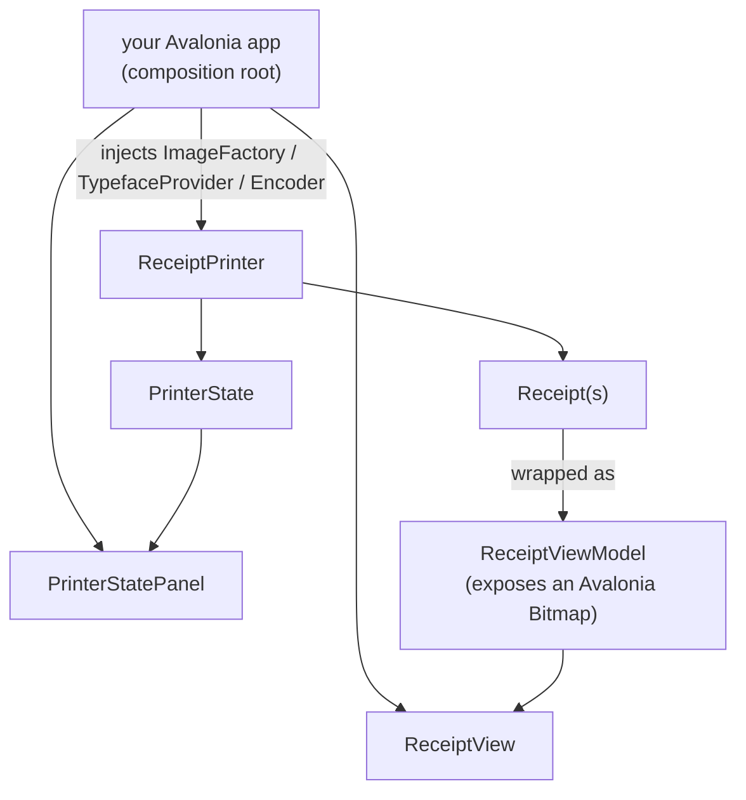

# Controls (`Tillroll.Controls`)

Reusable Avalonia controls so a host app can show a live receipt stream and drive the simulated printer
state. The controls are **backend-agnostic** — they depend on the abstraction, not on SkiaSharp. Your
app is the composition root that picks the render backend.



## Default theme

The controls take their colours, figure font and icons from a small resource dictionary. Merge it into your
application's resources; define the same keys after it to restyle them (Tillroll.App does this with its own
tokens):

```xml
<Application.Resources>
    <ResourceDictionary>
        <ResourceDictionary.MergedDictionaries>
            <ResourceInclude Source="avares://Tillroll.Controls/Themes/Default.axaml"/>
        </ResourceDictionary.MergedDictionaries>
    </ResourceDictionary>
</Application.Resources>
```

The keys are `PaperBrush`, `InkBrush`, `InkMutedBrush`, `AccentBrush`, `HoverBrush`, `PanelBrush`, `BorderBrush`,
`MonoFont` and `Icon.Download`.

## `ReceiptView`

Renders the live stream of receipts (one image per cut) with a per-page PNG export button. Bind its
`Receipts` property to an `IEnumerable` of `ReceiptViewModel`.

```xml
<UserControl xmlns:controls="using:Tillroll.Controls">
    <controls:ReceiptView Receipts="{Binding Receipts}" />
</UserControl>
```

Each receipt shows a caption under the paper (cut number, arrival time, length) and a **NEW** lamp until
`ReceiptViewModel.MarkSeen()` is called. The view also exposes `ScrollToEnd()` to keep the newest receipt in view,
`ScrollTo(item)` to bring one receipt to the top, and `VisibleItems()` for the receipts currently on screen.

## `PrinterStatePanel`

Two-way binds the simulated `PrinterState` (online, cover, paper, drawer, error, feed button). Toggling
it drives the status commands the emulator reports.

```xml
<controls:PrinterStatePanel State="{Binding State}" />
```

## Wiring it up

`ReceiptViewModel` wraps a `Receipt` and exposes a ready-to-bind Avalonia `Bitmap`. It reaches the
render backend only through `IImageEncoder`, so the control never sees SkiaSharp.

```csharp
using Tillroll.Controls;
using Tillroll.Controls.Services;
using Tillroll.Emulator;
using Tillroll.Rendering.Skia;   // or Tillroll.Rendering.ImageSharp

public partial class MainViewModel : ObservableObject
{
    private readonly ReceiptPrinter _printer;
    private readonly SkiaImageEncoder _encoder = new();
    private readonly IFileDialogService _dialogs;   // your Avalonia implementation

    public ObservableCollection<ReceiptViewModel> Receipts { get; } = new();
    public PrinterState State => _printer.State;

    public MainViewModel(IFileDialogService dialogs)
    {
        _dialogs = dialogs;
        _printer = new ReceiptPrinter(PaperConfiguration.Default, new SkiaImageFactory(), new SkiaTypefaceProvider());
        _printer.UiDispatch = a => Dispatcher.UIThread.Post(a);   // marshal off-thread state to the UI
    }

    private void Refresh()   // call after feeding ESC/POS
    {
        Receipts.Clear();
        int index = 1;
        foreach (var receipt in _printer.ReceiptStack)
        {
            if (receipt.IsEmpty) continue;
            Receipts.Add(new ReceiptViewModel(receipt, _encoder, _dialogs, index++));
        }
    }
}
```

## Host services

The controls depend on two small host-provided services (in `Tillroll.Controls.Services`):

- `IFileDialogService` — `SavePngAsync(suggestedName)` / `PickFolderAsync()` for the export buttons.
- `INotificationService` — surface buzzer / cash-drawer / activity events (sound, taskbar flash, …).

The desktop app provides Avalonia implementations; a browser/headless host can stub them (e.g. return
`null` from the dialogs to disable export).

## Converting an image yourself

If you render outside the view models, `AvaloniaImageExtensions` bridges an `IReceiptImage` to an
Avalonia `Bitmap` via PNG (no SkiaSharp dependency in your UI code):

```csharp
using Tillroll.Controls;
Bitmap bmp = receiptImage.ToAvaloniaBitmap(encoder);
```

## Not using Avalonia?

These controls are Avalonia, and they run unchanged in the browser — the [Browser App](Browser-App.md) is
the same Avalonia app compiled to WebAssembly, so there's nothing to re-mirror. If you're on a non-Avalonia
UI stack, the **model** underneath (`Receipt` / `PrinterState`) is plain and portable — render it however
your framework prefers.
