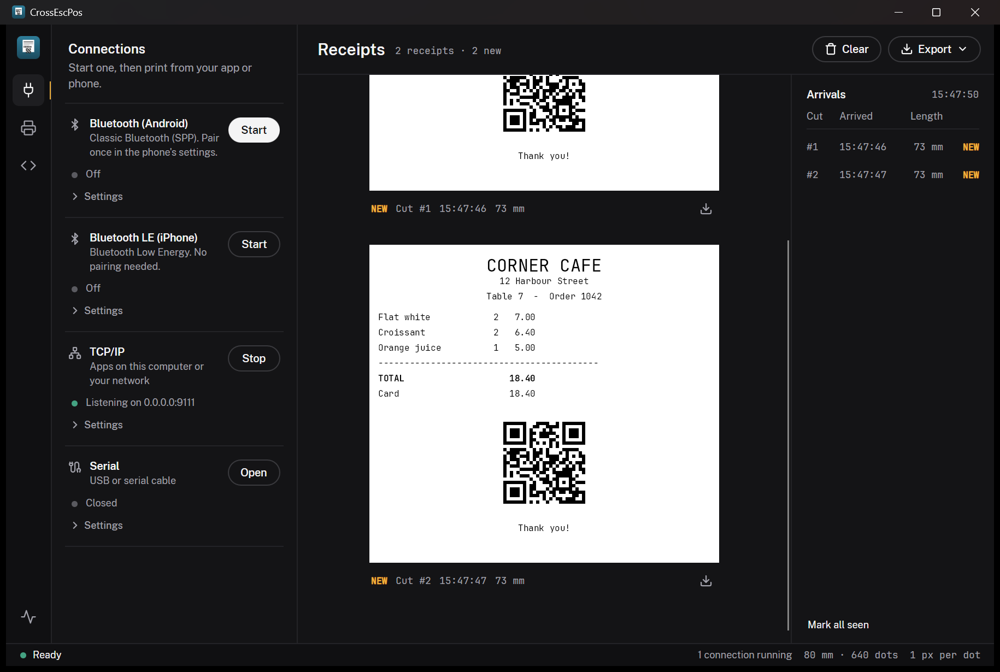

# Using the app

The window, the built-in Monitor test client, the printer panel, exporting receipts as PNG, and choosing the render
backend.

## The window



The same layout runs on Windows, Linux, macOS and in the browser:

- **Rail** (far left). Switches the side panel between **Connections**, **Printer** and **Test print**. Clicking the
  open one again closes the panel and gives the receipts the width. **Monitor** sits at the bottom.
- **Connections**. One card per transport, phones first: Bluetooth (Android), Bluetooth LE (iPhone), TCP/IP and
  Serial. Each has a Start button, a status line with a green dot while it runs, and its settings behind
  **Settings** (locked while it runs).
- **Printer**. Simulates the printer's state (online, cover, paper, errors, cash drawer, feed button), with a line
  under each switch saying what it does.
- **Test print**. Type or paste ESC/POS text and press **Render**; **Load sample** prints a receipt with barcodes
  and a QR code. Rendering replaces the receipts on screen.
- **Receipts**. Every cut appears as a paper slip, pixel for pixel, with its number, arrival time and length.
  **Clear** removes them and **Export** saves them (see below).
- **Arrivals**. One row per cut. A yellow lamp marks receipts you haven't looked at yet; it goes out when you
  move the pointer over the receipts or pick the row. Picking a row scrolls to that receipt. The board steps
  aside when the window is too narrow to show an 80 mm receipt pixel-exact beside it.
- **Status strip** (bottom). Whether the printer would print right now, and if not the first reason (offline,
  cover open, out of paper, an error). Click it to open the Printer panel. On the right: how many connections
  are running and the paper being emulated.

## Monitor (built-in test client)

Sending test jobs is the **monitor's** job — the emulator is the device, the monitor is the POS-side
client that drives it over the wire (just like a real application would). The Monitor is **shared** by
both heads: click **Monitor** at the bottom of the rail to open it — a window on desktop, an in-page
overlay in the browser. Its test jobs and status display are identical; only the transport differs:

- **Desktop** (built on [ESC-POS-.NET](https://github.com/lukevp/ESC-POS-.NET)) — pick a transport:
  - **TCP/IP** — connect to the emulator's listener (or any networked printer).
  - **Serial** — pick a port + baud; pairs with the emulator's serial transport via a virtual port bridge.
  - **USB** — print **directly to a real USB printer** selected from the connected-device list (by
    VID:PID), via libusb. This is send-only (no status), and needs native **libusb** installed
    (macOS `brew install libusb`, Debian/Ubuntu `apt install libusb-1.0-0`; bundled on Windows) and the
    OS not already holding the device.
- **Browser** — sends over the **SignalR proxy** (the `Tillroll.Host` hub) to the in-page emulator,
  for a full round-trip without any native transport.

It then lets you exercise the target without writing any code:

- Print a sample receipt, all 1D barcodes, or QR / PDF417 / DataMatrix / Aztec.
- Send the full feature test receipt, open the cash drawer, buzz, or cut.
- Watch the **printer status** the emulator reports back: toggle paper-out / cover / drawer / offline
  in the **Printer** panel and the monitor's status display updates live (via Automatic Status
  Back), confirming the emulator's status responses are wire-correct. When the printer isn't ready,
  the emulator drops the job and shows a notification, just like real hardware.


Toggling the emulator's **Printer** panel pushes status to the monitor in real time — here the
printer reports *paper low* and a *recoverable error*, so the monitor shows **Not ready**:


## Exporting tickets

Each cut (`ESC i` / `ESC m` / `GS V`) starts a new receipt — a "page". The **Export** menu above the
receipts saves the rendered tickets as PNG:

- **All receipts as one image…** — stacks every receipt into one tall PNG (a save dialog).
- **Each receipt to a folder…** — writes one `receipt_NNN.png` per cut into a chosen folder.

The download icon under a single receipt saves just that one.

## Choosing the render backend

Pick the render backend (for A/B testing the two rendering libraries) with `--backend skia`
(default) or `--backend imagesharp` (the managed, no-native backend). Hover the paper readout in the
status strip to see which backend is rendering.

```sh
dotnet run --project src/Tillroll.App.Desktop -- --backend imagesharp   # managed ImageSharp backend
dotnet run --project src/Tillroll.App.Desktop -- --backend skia         # default SkiaSharp backend
```

The `ESCPOS_RENDER_BACKEND` environment variable does the same; see [Connecting](Connecting.md#tcp-and-serial).
